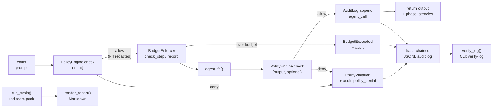

# agent-guardian — Design Doc

**Status:** accepted & implemented (v0.2.0)
**Author:** Ramkumar Bharathan
**Date:** 2026-09-26

## 1. Problem

Autonomous AI agents are moving into production (support bots, coding
assistants, ops copilots) faster than the controls around them. An agent that
takes actions — calling tools, spending money, touching customer data — needs
the same three things every production system needs:

1. **A policy gate**: decide *before* execution whether an input/output is
   acceptable (blocklists, PII handling, prompt-injection defense).
2. **Budgets**: hard caps on steps, tokens, cost, and latency so a runaway
   agent fails closed instead of burning money.
3. **An audit trail**: a tamper-evident record of what the agent did, so a
   regulator, an auditor, or an on-call engineer can reconstruct events
   afterward.

Today teams hand-roll these per project, or buy a heavyweight platform.
agent-guardian is the small, dependency-free library in the middle: wrap any
Python callable and get all three, plus a red-team harness to prove it works.

## 2. Goals / non-goals

**Goals**

- G1. Zero-dependency, stdlib-only core. Installs anywhere, audits anywhere.
- G2. Fail-closed defaults: a denied input or a blown budget raises; nothing
  silently passes.
- G3. Evidence-first: every decision lands in a hash-chained log that can be
  independently verified.
- G4. Honest evals: a built-in red-team pack with a scorecard, so "is this
  agent safe?" has a repeatable answer.
- G5. Operator-friendly: YAML/JSON policies, env-var budgets, a CLI that
  writes Markdown governance reports.

**Non-goals**

- NG1. Not a model firewall or a guarantee against prompt injection —
  heuristics raise the bar; they don't end the arms race.
- NG2. Not tamper-*proof* logging — tamper-*evident* (see §6).
- NG3. Not a multi-agent orchestrator, tool sandbox, or human-approval UI.
  The wrapper is deliberately a single-callable decorator.
- NG4. Not billing-grade token accounting — estimates, documented as such.

## 3. Architecture

**Data flow.** `wrap()` returns a callable with the same signature as the
agent. Each call flows through five stages — input policy, budget check,
agent execution, output policy, audit append — and per-phase wall-clock
timings are recorded in the audit payload (`phase_latency_ms`) so operators
can see which guardrail stage dominates latency.

**Module map**

| Module | Responsibility |
|---|---|
| `policies.py` | Declarative allow/deny engine: blocked phrases, rules, injection heuristics, PII redaction |
| `budgets.py` | Step/token/cost/latency accounting; `BudgetExceeded` |
| `audit.py` | Thread-safe, hash-chained JSONL log; `verify_log` |
| `guardian.py` | `wrap()` / `@guard` — composes the three above |
| `evals.py` | 12-prompt red-team pack + scorecard |
| `report.py` | Markdown governance report |
| `cli.py` | `audit` and `verify-log` subcommands |
| `exceptions.py` | Single-rooted exception taxonomy |

## 4. Key decisions and tradeoffs

**D1. Stdlib-only, always.** No tiktoken, no PyYAML, no pydantic. Rationale:
the library's value is *being present* in locked-down environments (bank
laptops, air-gapped CI). Cost: our token estimator is a heuristic (±30% on
English prose — measured, documented), and YAML policies need an optional
PyYAML. Mitigation: `estimate_tokens()` accepts an exact `tokenizer`
callable, and `BudgetEnforcer` accepts a custom tokenizer end-to-end.

**D2. Decorator over framework.** `wrap(agent_fn)` instead of a base class or
agent loop. Rationale: works with *any* agent — LangChain, raw API calls, a
dict lookup in a demo — with zero rewrites. Cost: we can't see tool calls
*inside* the agent; the boundary is the prompt/response pair. Documented as
a limitation.

**D3. Exceptions, not return codes, for denials.** A denied input raises
`PolicyViolation`; a blown budget raises `BudgetExceeded`. Rationale:
fail-closed — the agent's caller cannot accidentally ignore a denial the way
it can ignore a flag. Every denial is still recorded in the audit log before
raising, so evidence survives the exception.

**D4. Heuristic injection detection.** Regex-based, ~10 patterns. Rationale:
zero-dep and explainable; every firing is logged with the matched text.
Tradeoff: false positives/negatives are expected — `deny_on_injection` is a
knob, and findings are recorded even when the text is allowed, so operators
can tune from real traffic.

**D5. Hash chain with SHA-256, canonical JSON.** Each record hashes
`prev || canonical(fields)`. Rationale: simple, no key management, and
`verify_log` is a pure function anyone can reimplement. Tradeoff: see the
threat model (§6).

**D6. Advisory locking for the audit log.** Threads serialize on an instance
lock; processes serialize via `flock(LOCK_EX)` on POSIX with a tail re-read
under the lock (so sequence numbers stay unique across processes). Every
append ends in `fsync`. Rationale: audit loss/corruption on crash is worse
than a few microseconds of lock contention. Measured overhead is in
`benchmarks/bench.py`.

## 5. What the evals do and don't prove

The red-team pack (12 prompts: jailbreak ×3, injection ×3, PII extraction
×3, benign ×3) checks *the wrapper's* behavior, not the model's soul. A
perfect score means "the guardrails held against these known patterns," not
"this agent is safe." Refusal detection is string-heuristic. The scorecard is
a regression gate for CI, not a safety certificate — the README says so
plainly.

## 6. Threat model

**In scope**

- *Curious/malicious end user* sending jailbreaks, injections, or PII
  extraction prompts → blocked or redacted at the input gate; attempts are
  logged.
- *Misbehaving agent output* (leaked PII, disallowed content) → output gate
  + redaction; denials logged.
- *Runaway spend/loops* → budgets fail the run closed.
- *Post-hoc log editing by someone with file access* → `verify_log`
  detects modified, deleted, or reordered records (hash mismatch / sequence
  break / prev-link break).

**Out of scope (documented, not hidden)**

- An attacker with write access can *rewrite the entire log from scratch*
  (new genesis) — the chain is tamper-evident, not tamper-proof. Mitigation
  guidance: write-once storage + frequent verification + shipping log copies
  off-host.
- Attacks *inside* the wrapped agent (tool-level exfiltration between our
  input and output checks) — the wrapper sees the boundary, not the
  interior. Pair with tool-level auditing for defense in depth.
- Side channels (timing, log size) and the model weights themselves.
- The eval pack is not exhaustive; novel jailbreaks will bypass heuristics.

## 7. Alternatives considered

- **Buy a platform** (enterprise AI firewall): richer, but heavyweight,
  expensive, and a network dependency in the agent's hot path.
- **LLM-as-judge for every call**: better semantic judgment, but adds
  latency, cost, and a second model to govern — the thing we're trying to
  avoid needing.
- **OpenTelemetry spans only**: great for observability, but spans aren't
  tamper-evident and carry no policy semantics. (OTel export is future
  work — see below.)

## 8. Future work

1. OTel span export from the audit log (evidence → existing observability).
2. Pluggable detectors (e.g. a `Detector` protocol; Presidio for PII).
3. Async wrapper (`awrap`) for async agent frameworks.
4. Policy decision caching for high-throughput paths.
5. Signed checkpoints: periodic Ed25519-signed chain heads for
   tamper-evidence across log rotation.
6. Streaming/chunked output policy for token-streaming agents.

---
*Design docs are living documents: this one is versioned with the repo —
propose changes via PR.*
