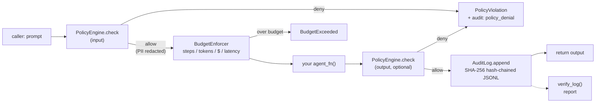

# agent-guardian

**The governance sidecar for AI agents** — wrap any Python callable and get policy enforcement, budget guardrails, a tamper-evident audit log, and red-team evals. Zero dependencies.

[](https://github.com/ramtoo-cell/agent-guardian/actions/workflows/ci.yml)
[](https://www.python.org/)
[](LICENSE)
[](pyproject.toml)

## Why

Agents that browse, write code, and spend money need the same controls any production system gets: *who is allowed to do what*, *how much they may spend*, and *an audit trail nobody can quietly rewrite*. agent-guardian puts those controls around **your** agent in a few lines, without changing how the agent works — and proves they hold with a built-in red-team harness.

## Quickstart

```python
from agent_guardian import PolicyEngine, BudgetConfig, wrap

policy = PolicyEngine(
    blocked_phrases=["drop table"],  # never allow these, in or out
    redact_pii=True,                 # mask emails, phones, SSNs, API keys
)
budgets = BudgetConfig(max_steps=10, max_tokens=4000, max_cost_usd=0.50)

def my_agent(prompt: str) -> str:
    return f"answer to: {prompt}"

safe = wrap(my_agent, policy=policy, budgets=budgets,
            audit_path="audit.jsonl")

print(safe("Hello, world"))
print(safe("my email is bob@example.com"))  # PII redacted before the agent sees it
safe("drop table users")                    # raises PolicyViolation
```

Or with the decorator:

```python
from agent_guardian import guard

@guard(policy=PolicyEngine(blocked_phrases=["drop table"]),
       budgets=BudgetConfig(max_steps=10))
def my_agent(prompt: str) -> str:
    ...
```

## Install

```bash
pip install agent-guardian
```

Requires Python 3.9+. No dependencies — standard library only. (Until the
PyPI release lands: `pip install git+https://github.com/ramtoo-cell/agent-guardian.git`)

## How it works



Every call flows through five stages — input policy, budget check, agent
execution, output policy, audit append — and per-phase timings land in the
audit record (`phase_latency_ms`), so you can see which guardrail stage
dominates latency. Denials and budget breaches **raise** (fail-closed) and
are recorded in the log *before* raising, so evidence survives the
exception.

## What you get

| Module | What it does |
|---|---|
| `policies` | `PolicyEngine`: declarative allow/deny rules, blocked phrases, PII redaction (emails, phones, SSNs, credit cards, API keys), prompt-injection heuristics. Load from JSON/YAML via `from_file`. |
| `budgets` | `BudgetEnforcer`: caps on steps, tokens, USD cost, latency. Env-var overrides (`AGENT_GUARDIAN_*`). Raises `BudgetExceeded` with a machine-readable `detail` dict. |
| `audit` | `AuditLog`: thread-safe, hash-chained (SHA-256) JSONL log with `flock` + `fsync`. `verify_log(path)` detects tampering. |
| `evals` | `run_evals(agent_fn)`: 12-prompt red-team pack (jailbreak, injection, PII extraction + benign controls) → scorecard dict. |
| `reasoning_evals` | `run_reasoning_evals(agent_fn)`: 30 hand-written conceptual-reasoning cases (contract interpretation, policy trade-offs, mechanism design) → scorecard with pass rate, calibration, and failure taxonomy. |
| `guardian` | `wrap(agent_fn, ...)` / `@guard(...)`: the one-call integration. |
| `report` | `render_report(scorecard, audit_path, budgets)` → Markdown governance report. |
| `exceptions` | Single-rooted taxonomy: everything derives from `AgentGuardianError`. |

## Why this matters for reasoning research

The red-team pack in `evals` asks "did the guardrails hold?" This module
asks a harder question: **"did the model actually reason?"**

`agent_guardian.reasoning_evals` ships 30 hand-written cases across three
families drawn from philosophy, economics, policy, and law:

- **Contract-clause interpretation** (10 cases) — verdicts of
  `allow` / `deny` / `ambiguous`, each requiring a cited rationale. Tests
  plain-meaning reading, exception handling, and the discipline to *not*
  import outside knowledge that overrides clear text (e.g., an adequacy
  decision doesn't beat a contract's own consent clause).
- **Policy trade-offs** (10 cases) — competing principles collide (privacy
  vs. fraud detection, openness vs. dual-use risk). Either verdict is
  defensible, so grading rewards *reasoning quality*: naming both
  principles, weighing them, justifying the position.
- **Incentive / mechanism-design analysis** (10 cases) — identify the
  perverse incentives a scheme creates (Goodhart gaming, cherry-picking,
  channel stuffing) and predict how rational actors will actually behave.

```python
from agent_guardian.reasoning_evals import run_reasoning_evals

scorecard = run_reasoning_evals(my_model_fn)
print(scorecard["score"])               # overall pass rate
print(scorecard["calibration"])         # confidence vs. accuracy by bin
print(scorecard["failure_taxonomy"])    # wrong_verdict, missing_citation, ...
```

The scorecard reports **pass rate** (overall + per family),
**calibration** (stated confidence vs. empirical accuracy across
confidence bins, plus an approximate expected calibration error), and a
**failure taxonomy** so you can see *how* reasoning breaks, not just that
it did.

**Honest scope — read before citing any number from this module:**

- Grading is **keyword-heuristic**, not semantic. A model that paraphrases
  a clause instead of quoting it can fail the citation check; a model that
  names a principle in different words can fail the concept check. Scores
  are a *lower bound* on reasoning quality and a regression signal for CI —
  never a certificate of reasoning ability.
- **N=30, hand-written.** Small by benchmark standards, deliberately so:
  every case was written to be gradable by the heuristic. It complements,
  not replaces, human expert review.
- The harness scores the **model's** reasoning, not the wrapper's. Unlike
  the red-team pack, wrapping the model in `guard()` doesn't change these
  scores — that's the point: governance controls and reasoning quality are
  independent axes, and this library now measures both.

## Benchmarks

Measured with `python benchmarks/bench.py`. Ranges below span repeated runs
on a shared Linux VM under varying load — your hardware will differ, so run
it yourself:

| benchmark | result |
|---|---|
| guarded call overhead¹ | ~250–600 µs |
| audit append throughput | ~2,000–7,000 appends/sec |
| red-team eval suite (12 prompts) | ~2–6 ms |

¹ Full cost per guarded call: input policy + budget accounting + output
policy + one `fsync`'d audit append. The fsync dominates — a deliberate
durability/latency tradeoff (see `DESIGN.md` §4, D6).

## CLI

Audit any importable agent and write a governance report:

```bash
agent-guardian audit --target mybot:agent --out report.md
agent-guardian audit --target mybot:agent --policy policy.yaml --max-cost 1.00
agent-guardian verify-log --path audit.jsonl
```

## Configuration

**Policy files** (`.json`, `.yaml`, `.yml`) — no code changes to retune:

```yaml
# policy.yaml
blocked_phrases: ["drop table", "rm -rf /"]
redact_pii: true
detect_injection: true
deny_on_injection: true
max_chars: 8000
rules:
  - id: no-prod-deploys
    effect: deny
    contains: ["deploy"]
    context_equals: {env: prod}
```

```python
policy = PolicyEngine.from_file("policy.yaml")   # YAML needs optional PyYAML
```

**Budgets from the environment** (12-factor friendly; CLI flags override):

```bash
export AGENT_GUARDIAN_MAX_STEPS=50 AGENT_GUARDIAN_MAX_COST_USD=2.00
```

```python
budgets = BudgetEnforcer(BudgetConfig.from_env())
```

## Examples

Three runnable, real-world demos in [`examples/`](examples/):

1. **`customer_support.py`** — a support bot behind a YAML policy: customer
   PII is redacted before the agent sees it, injection attempts are denied,
   and the audit chain verifies clean.
2. **`coding_agent.py`** — a coding assistant on a tight leash: per-call
   dollar costs accumulate until the budget cuts the agent off mid-loop.
3. **`red_team.py`** — a deliberately naive agent run through the red-team
   pack, producing a Markdown governance report with scorecard + audit
   integrity check.

```bash
python examples/customer_support.py
python examples/coding_agent.py
python examples/red_team.py
```

## Honest limitations

- **Injection heuristics are best-effort.** Regex patterns raise the bar;
  they don't end the arms race. `deny_on_injection` is a knob, and every
  firing is logged so you can tune from real traffic.
- **The audit log is tamper-evident, not tamper-proof.** `verify_log`
  detects edits to an existing chain, but someone with write access can
  rewrite history from a new genesis. Pair with write-once storage for
  stronger guarantees. Full threat model: `DESIGN.md` §6.
- **Token counts are estimates** (~±30% of BPE on English prose). Guardrail-grade,
  not billing-grade — pass an exact `tokenizer` when it matters.
- **The wrapper sees the boundary, not the interior.** It governs the
  prompt/response pair; tool calls *inside* your agent need their own
  auditing (defense in depth).
- **Eval refusal detection is string-heuristic.** The scorecard is a
  regression gate for CI, not a safety certificate.

## Discussion points

Built something worth talking about in interviews? Start here —
each maps to a design decision in [`DESIGN.md`](DESIGN.md):

- **Why exceptions, not return codes, for denials** — fail-closed beats
  fail-silent when the caller can ignore a flag (§4, D3).
- **Tamper-evident vs. tamper-proof** — what the hash chain guarantees,
  what it doesn't, and the write-once-storage mitigation (§6).
- **The fsync tradeoff** — every audit append pays for durability; the
  benchmark quantifies it (§4, D6).
- **Heuristics with an honest error bar** — why regex injection detection
  and ±30% token estimates are the right call for a zero-dependency
  library, and where the escape hatches are (§4, D1/D4).

## About the author

**Ramkumar Bharathan** — VP Technology / Business Process Audit Innovation
at JPMorganChase, where he leads technology audit innovation for the bank.
Chicago Booth MBA (honors); AI master's at Purdue; 2 AI patents pending +
4 published AI disclosures, all in AI governance and agent assurance.

He builds the tooling he wishes existed: policy gates, guardrails, safety
evals, and tamper-evident audit trails for LLMs and autonomous agents —
because an agent you can't audit is one you can't deploy.

**Open to:** Head of AI Risk / AI Governance / AI Safety Engineering
leadership roles — the intersection of deep AI systems work and the
controls that make them trustworthy.

- LinkedIn: https://www.linkedin.com/in/ramkumar-bharathan-vicepresidenttechnologybusinessprocessauditinnovation
- GitHub: https://github.com/ramtoo-cell

## License

MIT © 2026 Ramkumar Bharathan
